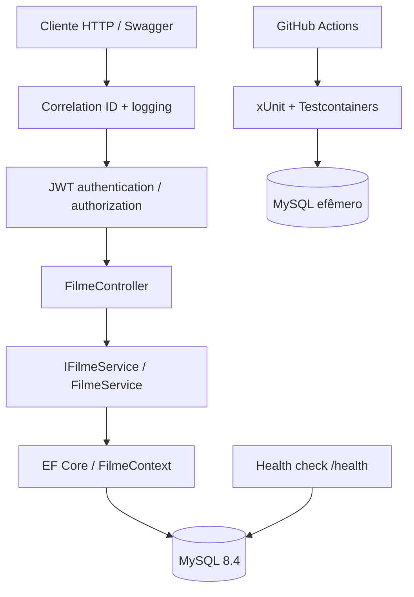

# Arquitetura — FilmesAPI

## Decisões

- API ASP.NET Core .NET 10, controllers finos e serviço de aplicação.
- EF Core 9 / Pomelo MySQL, migrations versionadas.
- GET público; POST, PUT e DELETE exigem JWT assinado por chave configurada fora do repositório.
- Paginação server-side com ordenação por Id e limite de 100 itens por página.
- Logs estruturados com duração da requisição e X-Correlation-ID; health check com conexão ao banco.
- Testes unitários e integração com Testcontainers, executados no GitHub Actions.

## Limitações intencionais

O projeto **valida** tokens JWT, mas não emite tokens nem implementa login/gestão de usuários. Use um emissor JWT confiável com issuer/audience/chave compatíveis. Em produção prefira identidade externa com chaves assimétricas (OIDC/JWKS), autorização por políticas, rate limiting e telemetria OpenTelemetry. Não exponha a chave JWT no repositório.
